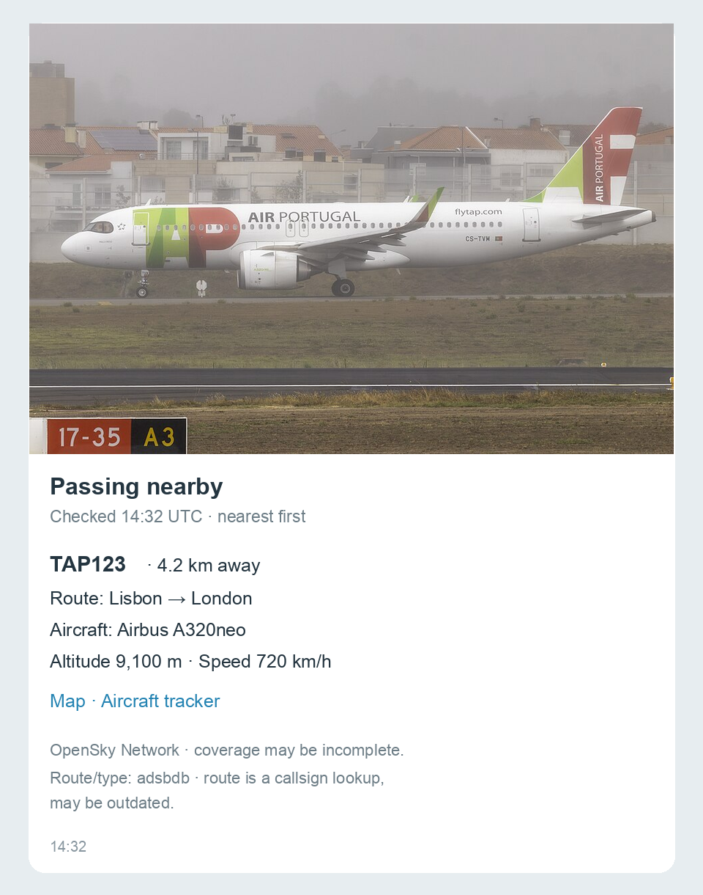

# Flight card preview

A static illustration of the single Telegram alert: aircraft photo and flight details in one message, with no additional GIF. Flight data is fictional; Telegram controls the actual card layout. Production uses a photo of the detected aircraft when available and falls back to the same information as text.

Photo: [CS-TVM A320neo TAP OPO 01.jpg](https://commons.wikimedia.org/wiki/File:CS-TVM_A320neo_TAP_OPO_01.jpg) by Bene Riobó, [CC BY-SA 4.0](https://creativecommons.org/licenses/by-sa/4.0/). The photo was resized and placed in an illustrated message card; this preview image is also licensed under CC BY-SA 4.0.
